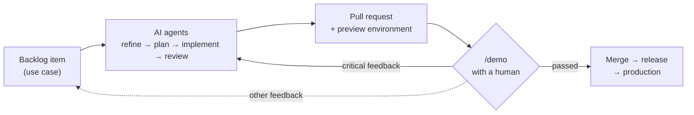

# blueprint

**A project template where AI agents take work from backlog item to production, and humans demo and decide.**

An opinionated Spring Boot 4 + React template with continuous delivery to Fly.io, per-PR preview environments, and an AI workflow kit for Claude Code built in.

> **Status: design phase.** Nothing here is usable yet. The architecture is being decided and recorded as [Architecture Decision Records](docs/adr/README.md). Open topics are listed in [docs/deferred.md](docs/deferred.md).

## How it works

1. Work lives in an in-repo **backlog** as Cockburn-style use cases ([0074](docs/adr/0074-implemented-backlog-items-are-deleted.md), [0062](docs/adr/0062-backlog-items-as-cockburn-use-cases.md)).
2. A scheduled **Claude Code agent** picks the next item and runs it through a chain of skills: refine, plan, implement, review + ship. Acceptance tests are written first ([0042](docs/adr/0042-sdlc-skill-chain.md), [0046](docs/adr/0046-autonomous-backlog-loop.md)).
3. Every pull request gets its own **preview environment** ([0055](docs/adr/0055-previews-on-fly-dev-and-environment-parity.md), [0064](docs/adr/0064-preview-databases-in-shared-neon-branch.md)).
4. For user-visible changes, a human runs **`/demo`**. Claude walks them through the preview, and their feedback either fixes the PR or goes into the backlog ([0044](docs/adr/0044-interactive-demo-and-feedback-triage.md), [0057](docs/adr/0057-demo-only-for-user-visible-changes.md)).
5. When checks are green and the demo has passed, the agent merges. **semantic-release** then ships to production, with snapshots and automatic rollback as the safety net ([0043](docs/adr/0043-autonomous-merge-gated-by-demo.md), [0029](docs/adr/0029-pre-migration-neon-snapshots-and-auto-rollback.md)).

New projects are created from the template with **`/bootstrap`** and can pull in later template improvements with **`/sync-blueprint`** ([0047](docs/adr/0047-bootstrap-skill.md), [0048](docs/adr/0048-sync-blueprint-skill.md)).

## Stack at a glance

| Area | Choice |
|---|---|
| Backend | Spring Boot 4, Java 25, Gradle (Groovy DSL); Spring Modulith modules with onion layers ([0004](docs/adr/0004-spring-boot-and-react-stack.md), [0008](docs/adr/0008-modulith-modules-with-onion-layers.md)) |
| Frontend | React, Vite, TypeScript, React Router, CSS Modules, pnpm ([0016](docs/adr/0016-frontend-vite-typescript-react-router.md), [0017](docs/adr/0017-css-modules-for-styling.md)) |
| API | Spec-first OpenAPI; AsyncAPI for WebSocket events ([0014](docs/adr/0014-spec-first-openapi.md), [0015](docs/adr/0015-asyncapi-for-websocket-events.md)) |
| Data | PostgreSQL on Neon, Flyway migrations (expand/contract) ([0025](docs/adr/0025-neon-as-production-database.md), [0013](docs/adr/0013-expand-contract-migrations.md)) |
| Hosting | One container image (Jib) on Fly.io, behind Cloudflare ([0005](docs/adr/0005-single-deployable-jar.md), [0022](docs/adr/0022-fly-io-hosting.md), [0052](docs/adr/0052-cloudflare-in-front-of-production.md)) |
| CI/CD | GitHub Actions, semantic-release, Dependabot ([0031](docs/adr/0031-github-actions-ci-cd.md), [0032](docs/adr/0032-semantic-release-and-conventional-commits.md)) |
| Testing | Acceptance-test first: Playwright, JGiven, Testcontainers, Vitest ([0038](docs/adr/0038-acceptance-test-first.md)) |
| Quality | Spotless, Error Prone/NullAway, ESLint, SonarCloud, CodeQL ([0034](docs/adr/0034-code-quality-and-security-tooling.md)) |
| AI kit | Claude Code first; AGENTS.md as the source of truth ([0041](docs/adr/0041-claude-code-first-agents-md.md)) |

## Prerequisites

To run a project created from blueprint you'll need:

- **GitHub**: repository, Actions, Container Registry and Pages
- **Fly.io**: hosting for production and previews
- **Neon**: serverless PostgreSQL
- **Cloudflare** (free plan): **your own domain** managed by Cloudflare, which is mandatory ([0052](docs/adr/0052-cloudflare-in-front-of-production.md))
- **SonarCloud**: free for public repositories
- **Claude Code**, for the AI workflow

The complete list of accounts, secrets and settings is in [docs/setup.md](docs/setup.md).

**Rough costs:** Neon, Cloudflare and SonarCloud have free tiers that cover a typical project. Fly.io has no real free tier for new accounts, but with scale-to-zero, a low-traffic project usually costs **a few dollars a month (roughly $0–10)**. Add **about €10–15 a year** for the domain. These are estimates. Check the providers' current pricing before you start.

## License

[Apache-2.0](LICENSE)
